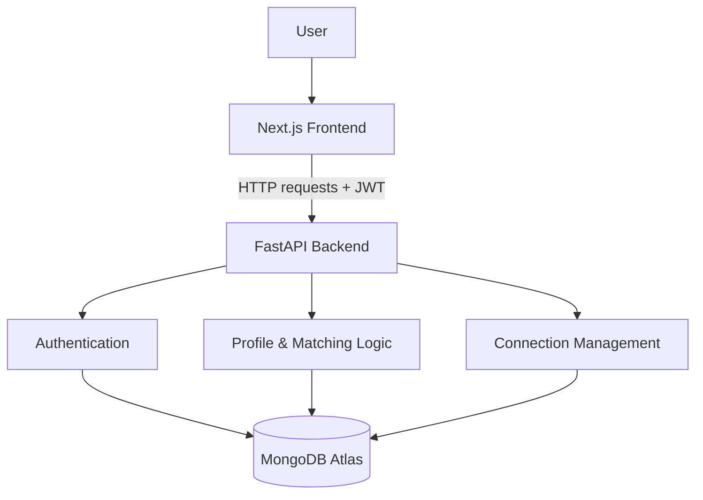

 
<div align="center">

<a href="https://github.com/vedanthpatil1706/RoomieMatch">
  
</a>

<h3>🏠 Find your people. Find your place.</h3>

<p>A full-stack roommate matching platform that helps people discover compatible flatmates through lifestyle preferences, budgets, location, interests, and university details.</p>

<p>
  
  
  
</p>

<p>
  <a href="#-features">Features</a> •
  <a href="#-technology-stack">Tech Stack</a> •
  <a href="#-how-matching-works">Matching</a> •
  <a href="#-getting-started">Getting Started</a> •
  <a href="#-project-structure">Structure</a>
</p>

</div>

---

## ✨ About the Project

Finding a roommate is about more than finding someone who can split the rent. RoomieMatch helps users discover people whose living habits and preferences may fit their own.

Users can create a profile, explore potential matches, compare compatibility scores, send connection requests, and view the full profiles of people they are connected with.

> **The goal:** Make the search for a compatible flatmate more structured, transparent, and personal.

## 🚀 Features

| Feature | Description |
|---|---|
| 🔐 Authentication | User registration and login with token-based authentication |
| 👤 Profile Management | Save age, gender, university, city, budget, lifestyle, and interests |
| 🎯 Smart Matching | Compare profile preferences and calculate compatibility scores |
| 📊 Match Breakdown | Show compatibility across individual matching categories |
| 🤝 Connection Requests | Send, receive, accept, and reject roommate requests |
| 🔗 Connections | View accepted connections |
| 🪪 Profile Viewing | View another user's detailed profile after an accepted connection |
| 📱 Responsive UI | Modern Next.js interface styled with Tailwind CSS |

## 🧠 How Matching Works

RoomieMatch calculates a compatibility score using six profile dimensions.

| Matching Factor | Weight |
|---|---:|
| 💰 Budget Compatibility | 30% |
| 📍 City | 20% |
| 🌙 Lifestyle | 20% |
| 🥗 Food Preference | 10% |
| 🎨 Shared Interests | 10% |
| 🎓 University | 10% |
| **Total** | **100%** |

The dashboard presents an overall compatibility score along with a category-wise breakdown, helping users understand where their preferences align.

*The score is a profile-based compatibility indicator, not a guarantee that two people will be ideal roommates.*

## 🛠️ Technology Stack

| Layer | Technologies |
|---|---|
| Frontend | Next.js, React, TypeScript |
| Styling | Tailwind CSS |
| Backend API | Python, FastAPI, Uvicorn |
| Database | MongoDB Atlas, PyMongo |
| Authentication | JWT (HS256), password hashing with `hashlib.scrypt` |
| Development Tools | VS Code, Git, GitHub |

### 🔍 Tools and Technologies

<p>
  
</p>

## 🏗️ Application Architecture



## 📂 Project Structure

```text
RoomieMatch/
│
├── backend/
│   ├── app/
│   │   ├── __init__.py
│   │   ├── database.py
│   │   └── main.py
│   └── requirements.txt
│
├── frontend/
│   ├── public/
│   ├── src/
│   │   └── app/
│   │       ├── components/
│   │       │   └── Navbar.tsx
│   │       ├── connections/
│   │       ├── dashboard/
│   │       ├── profile/
│   │       ├── roommate/
│   │       ├── globals.css
│   │       ├── layout.tsx
│   │       └── page.tsx
│   └── package.json
│
└── .gitignore
```

## ⚙️ Getting Started

Follow these steps to run RoomieMatch locally.

### 1. Clone the Repository

```bash
git clone https://github.com/vedanthpatil1706/RoomieMatch.git
cd RoomieMatch
```

### 2. Configure the Backend

```bash
cd backend
python -m venv .venv
```

Activate the virtual environment.

**Windows PowerShell:**

```powershell
.venv\Scripts\Activate.ps1
```

Install dependencies:

```bash
pip install -r requirements.txt
```

Create a `backend/.env` file and configure the environment variables required by `backend/app/database.py` and `backend/app/main.py`, such as your MongoDB connection URI and JWT secret. Use the exact variable names expected by your backend code.

Start the backend:

```bash
python -m uvicorn app.main:app --reload
```

Backend API:

`http://127.0.0.1:8000`

Interactive API documentation:

`http://127.0.0.1:8000/docs`

### 3. Configure the Frontend

Open a second terminal:

```bash
cd frontend
npm install
```

Configure the frontend API base URL to point to your backend. For local development, the current application uses:

```text
http://127.0.0.1:8000
```

Start the frontend:

```bash
npm run dev
```

Frontend:

`http://localhost:3000`

### 4. Create Your Account

1. Open the frontend in your browser.
2. Register a new account.
3. Complete your roommate profile.
4. Explore potential matches.
5. Send or respond to connection requests.

## 🔒 Security Notes

- Never commit `.env` files, database credentials, JWT secrets, or private keys.
- Keep secrets in environment variables on your deployment platform.
- Restrict MongoDB Atlas network access appropriately for your deployment.
- Use HTTPS and production-grade secret values when deploying.
- The `.gitignore` file excludes local environment and generated files.

## 🗺️ Roadmap

- [ ] Deploy the frontend and backend.
- [ ] Add profile photos and richer profile presentation.
- [ ] Add filters for city, budget, university, and lifestyle.
- [ ] Improve match explanations and preference controls.
- [ ] Add notifications for incoming connection requests.
- [ ] Add automated tests for authentication, matching, and connections.
- [ ] Add a polished product demo with screenshots.

## 🖼️ Screenshots

Screenshots will be added here as the interface is finalized.

## 🤝 Contributing

Suggestions, bug reports, and improvements are welcome. Feel free to open an issue or submit a pull request.

## 👨‍💻 Author

**Vedant Patil**

- GitHub: [@vedanthpatil1706](https://github.com/vedanthpatil1706)
- Project: [RoomieMatch](https://github.com/vedanthpatil/RoomieMatch)

---

<div align="center">

### 🏠 RoomieMatch

**Find your people. Find your place.**

<sub>Built with curiosity, code, and the idea that better shared living starts with better compatibility.</sub>

</div>
