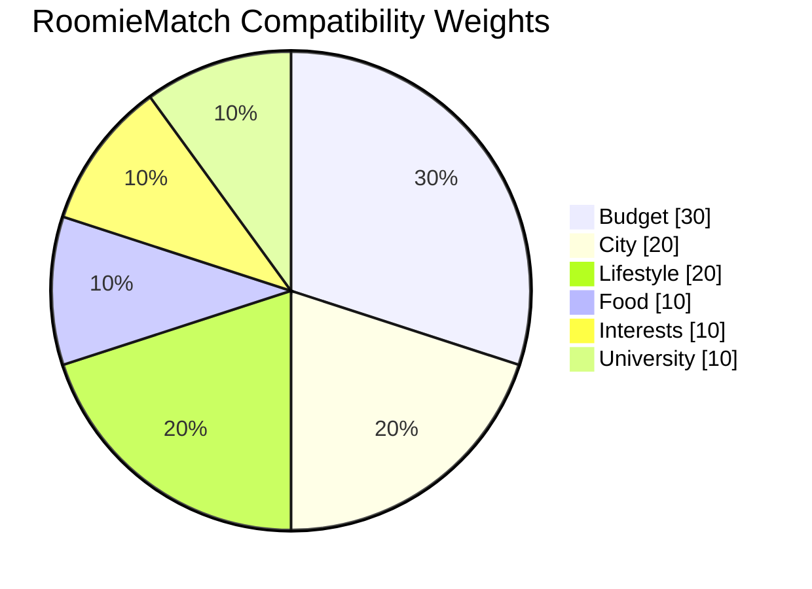
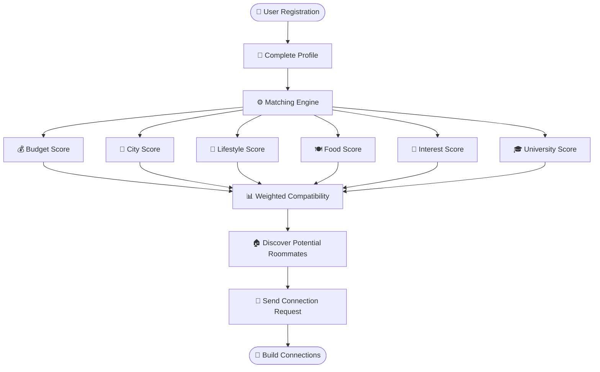
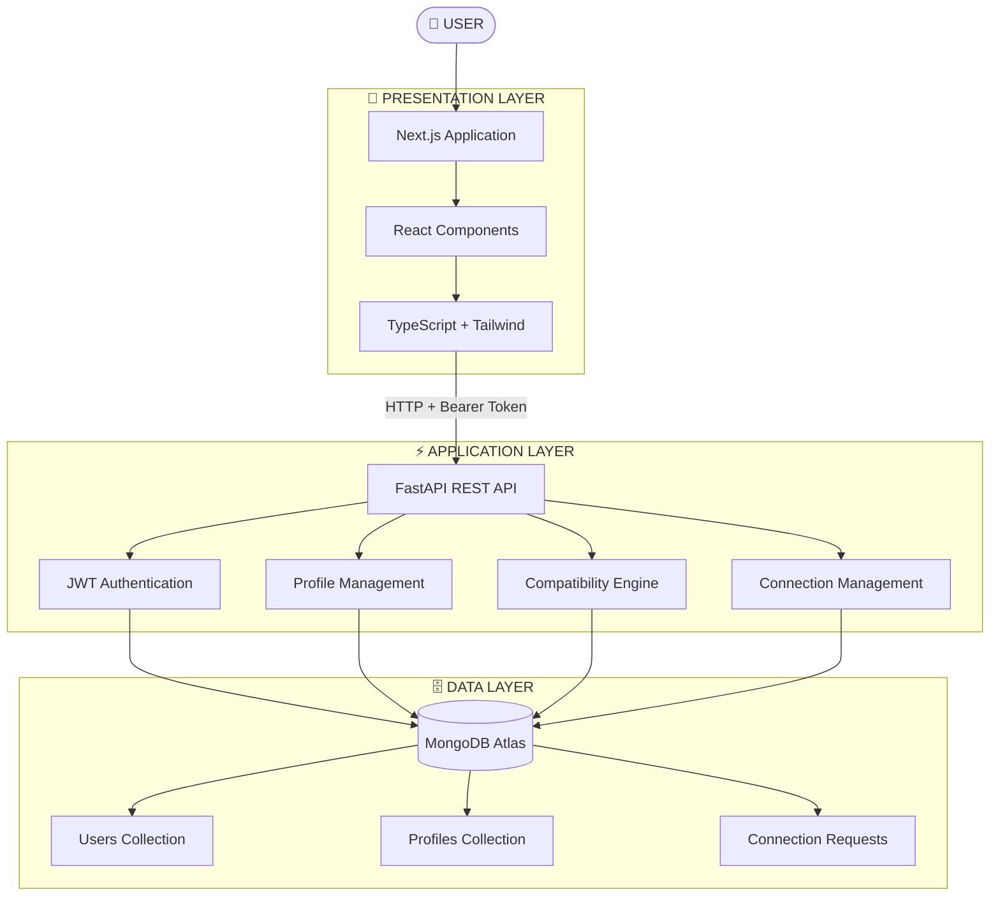

 

 

  

 

  

**[ EXPLORE REPOSITORY ](https://github.com/vedanthpatil1706/RoomieMatch)**

---

# ◈ THE NEXT GENERATION OF SHARED LIVING

### More than a roommate search. A compatibility-driven living experience.

RoomieMatch is a full-stack roommate discovery platform designed to help people find compatible flatmates based on their budget, location, lifestyle, food preferences, university, and shared interests.

Instead of choosing a roommate randomly, users can explore compatibility scores, understand matching factors, send connection requests, and build meaningful connections.

**One platform. Six compatibility dimensions. Better roommate decisions.**

---

## ◈ 01 — THE EXPERIENCE

| 🎯 SMART MATCHING | 📊 MATCH ANALYTICS | 🤝 CONNECTIONS |
|:---:|:---:|:---:|
| Weighted compatibility scoring | Category-wise score breakdown | Request and accept connections |

| 👤 PERSONAL PROFILES | 🔐 AUTHENTICATION | 🏠 ROOMMATE DISCOVERY |
|:---:|:---:|:---:|
| Lifestyle and budget preferences | JWT-based login | Explore potential flatmates |

### ⚡ Core Features

- **Secure Authentication:** Register and log in with protected API access.
- **Personalized Profiles:** Add age, gender, university, city, monthly budget, food preference, sleep schedule, smoking, drinking, and interests.
- **Compatibility Engine:** Compare potential roommates using six weighted dimensions.
- **Visual Match Analytics:** Understand compatibility through individual category scores.
- **Connection Requests:** Send, receive, accept, and reject requests.
- **Connected Profiles:** View detailed roommate information after an accepted connection.
- **Responsive Interface:** A modern Next.js interface with a custom dark visual identity.

---

## ◈ 02 — THE COMPATIBILITY ENGINE

RoomieMatch calculates a weighted compatibility score using six dimensions.

### The matching model

| Dimension | Weight | Purpose |
|:---|:---:|:---|
| 💰 Budget Compatibility | **30%** | Compare overlapping accommodation budgets |
| 📍 City Compatibility | **20%** | Compare preferred living locations |
| 🌙 Lifestyle Compatibility | **20%** | Compare smoking, drinking, and sleep schedules |
| 🍽️ Food Compatibility | **10%** | Compare food preferences |
| 🎯 Shared Interests | **10%** | Identify common interests |
| 🎓 University Compatibility | **10%** | Compare university information |
| **TOTAL** | **100%** | **Weighted compatibility score** |

### Visual weight distribution

### How the matching process works

> **Scoring note:** The compatibility percentage is a profile-based indicator calculated using the implemented weighted rules. It is not a machine-learning prediction or a guarantee of roommate suitability.

---

## ◈ 03 — TECHNOLOGY MATRIX

### POWERED BY A MODERN FULL-STACK ECOSYSTEM

### Frontend

| Technology | Role |
|:---|:---|
| Next.js | Frontend framework |
| React | Component-based UI |
| TypeScript | Type-safe frontend development |
| Tailwind CSS | Styling and responsive layouts |

### Backend

| Technology | Role |
|:---|:---|
| Python | Backend programming |
| FastAPI | REST API development |
| Uvicorn | ASGI server |
| PyMongo | MongoDB connectivity |

### Database & Security

| Technology | Role |
|:---|:---|
| MongoDB Atlas | Cloud database |
| JWT | Authentication tokens |
| HS256 | JWT signing algorithm |
| hashlib.scrypt | Password hashing |
| Git & GitHub | Version control and source hosting |

### Development Environment

---

## ◈ 04 — SYSTEM ARCHITECTURE

### THE ROOMIEMATCH ECOSYSTEM

### Architecture responsibilities

| Component | Responsibility |
|:---|:---|
| Next.js | User interface and navigation |
| FastAPI
